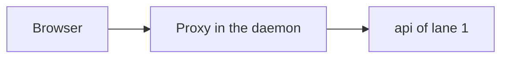

# Markdown the website renders

Pages are `.md` files with the directives below. No MDX, no HTML, no components.

## Frontmatter

```yaml
---
title: Share one Postgres between lanes
description: Run one Postgres container for every lane and give each lane its own database in it.
kind: how-to
---
```

- `title`: sentence case. The page has no `#` heading; the website renders the title.
- `description`: one sentence, shown in search results and in `llms.txt`. Plain words, no inline code.
- `kind`: `overview` (the docs home only), `learn`, `how-to`, `concept` or `reference`. Any other value fails the website build. `troubleshooting.md` is `reference`.
- The pages under `docs/errors/` are the exception to all of the above: each keeps its `# DL101 Unknown host` heading and a frontmatter of exactly `sidebar: order: <number>`, because a test in `crates/pages` checks both against the pages the proxy serves. Link one by its heading text.
- `sidebar: { label: Overview }` gives a page a sidebar label that differs from its title. `docs/README.md` and `docs/errors/README.md` use it.
- `publish: false` keeps a file off the website. `docs/AGENTS.md` has it.

## File names

Lowercase words joined by hyphens. No page is named `agents.md` or `claude.md`: on Windows and macOS an agent's harness reads such a file as its instructions, whatever the letter case.

## Sidebar

`docs/nav.yaml` lists every page in sidebar order. A page missing from it lands in the last group with a build warning, and a path in it that names no page fails the build. Add a new page to `nav.yaml` and to the site map in the same change, and take a deleted one out of both.

## Links

- Link another docs page by its relative path with the `.md` extension: `[Throttling and freezing](../concepts/freezing.md)`. The website turns it into the route.
- Link a heading with `#` and its slug: `../concepts/ports.md#named-ports`.
- Link text names the page or the thing. Never "here" or "this page".
- The config reference is generated on the website, so link it by route. Never create `docs/reference/config.md`: the website writes that page. A project file key lives at `/docs/reference/config/project/<top-level key>/` and a user config key at `/docs/reference/config/user/<top-level key>/`, each with an anchor made from the dotted path: lowercase, `<` and `>` removed, `[]` dropped, dots turned into `-`. The link text is the full dotted key in code, never its last part alone: [`services.<name>.ready`](/docs/reference/config/project/services/#services-name-ready). An item of a list is written with `[]`, as in `services.<name>.hosts[].host`, and a key that takes one entry or a list uses the list form. A link to a whole reference uses its title: [Project file reference](/docs/reference/config/project/) or [User config reference](/docs/reference/config/user/).
- A proxy error page is linked by its own title, such as [DL201 Service not running](../errors/service-idle.md).

## Terminal blocks

````markdown
```console title="on the box"
$ devlanes daemon pair
```
````

- A block holds the commands a person types, one per line, each starting with `$ `. `PS> ` starts a PowerShell command. No output: the reader runs the command and sees it.
- `title` names where the commands run when that matters: "on the box", "on your machine".
- Commands that share a block are run one after another.

## Prompt blocks

````markdown
```prompt
Install the devlanes skill:
npx skills add devlanes-run/devlanes --skill devlanes

Then install devlanes on this machine if it is missing, set it up for
this repository, start it and give me the URL of each service.
```
````

Text for the reader to paste into a coding agent. Break its lines by hand at about 70 characters, with the skill's install command on a line of its own, so the block needs no sideways scrolling on the website or on GitHub. A prompt says "install devlanes if it is missing" when it needs the command, because the skill installs it only when asked. It renders as a card with a copy button. Write it as one instruction a person would give, in plain sentences. Use it on the overview and the install page, and on a how-to guide when the guide, or its first step, is something an agent does.

## Config blocks

````markdown
```yaml devlanes
services:
  api:
    run_script:
      file: api/package.json
      name: dev
    hosts: "api.${{ lane.domain }}"
```
````

- `yaml devlanes` is a project file or a fragment of one. `yaml devlanes-user` is the user config.
- A first-line comment with a file name sets the tab title: `# devlanes.local.yaml`.
- Each key shows its description on hover and links to the reference. An unknown key fails the website build.
- Show the lines a step is about. A whole file only on the page that first builds it.
- Plain `yaml` is for other files: Compose files, CI workflows. Other files take their own language: `js`, `json`, `toml`, `sh`, `powershell`, `ssh-config`, and `text` when nothing fits. A `title` names the file.
- Comments in a config block say why a line is there. They do not repeat the hover.

## Tabs

```markdown
::::tabs{sync="os"}
:::tab[macOS]
...
:::
:::tab[Linux]
...
:::
:::tab[Windows]
...
:::
::::
```

Tabs with the same `sync` key switch together, and they are matched by the text of the label. So a key has one fixed set of labels, spelled the same on every page:

| `sync` | Labels |
|---|---|
| `os` | macOS, Linux, Windows |
| `shell` | bash, zsh, fish, PowerShell |
| `install` | Homebrew, npm, uv, cargo |
| `agent` | Claude Code, Codex, OpenCode, Cursor |

A page leaves out the labels it has nothing for, and never joins two ("macOS and Linux"). When two systems share the content, each gets its own tab with the content repeated. Use tabs only where the content differs by that key. Tabs by anything else, such as a framework or a datastore, are `::::tabs` with no `sync`, and switch alone. A page with several tab groups by the same thing gives them a key of its own so they switch together: `sync="runtime"` on the runtimes guide.

## Steps

```markdown
:::steps
1. Install devlanes on the box.
2. Run `devlanes daemon pair` there.
3. Connect from your machine.
:::
```

For a short run of actions inside a how-to guide. Longer procedures are sections.

## Examples

```markdown
::example{slug="infra-postgres-shared"}
```

The slug is a `slug` from `catalog.json` in the examples repository whose `status` is `ready`. One card per page, placed after the opening line of a how-to guide. Each example has a page of its own at `https://devlanes.run/examples/<slug>/`, and `/examples/` lists them; link an example in prose by that route, as `[infra-postgres-shared](/examples/infra-postgres-shared/)`.

## The TUI

```markdown
::tui{view="lanes"}
```

A live TUI on the page. `view` is `lanes`, `monitor`, `daemon` or `boxes`. It renders nothing when the website was built without the TUI bundle, so the page has to read correctly without it. `reference/tui.md` is the page that uses it.

## Diagrams

````markdown

````

A diagram is a Mermaid block in the page, so it is text that shows in a diff and that an agent can read and edit. No image files.

- `flowchart` for boxes and arrows, with `subgraph` for one thing inside another. `stateDiagram-v2` for states.
- Put every label in double quotes. Break a line with `<br/>`.
- No colours or styles: the website themes the diagram.
- Declare a `subgraph` before an arrow points at it.
- A diagram shows the model in a handful of boxes. When a list or a small table says the same thing, use that.

## Asides

```markdown
:::caution
`devlanes lane clean` deletes the lane's data.
:::
```

`:::note`, `:::tip`, `:::caution` and `:::danger`. Use one only for something a reader loses data or time by missing. A page with more than one aside has a structure problem.
