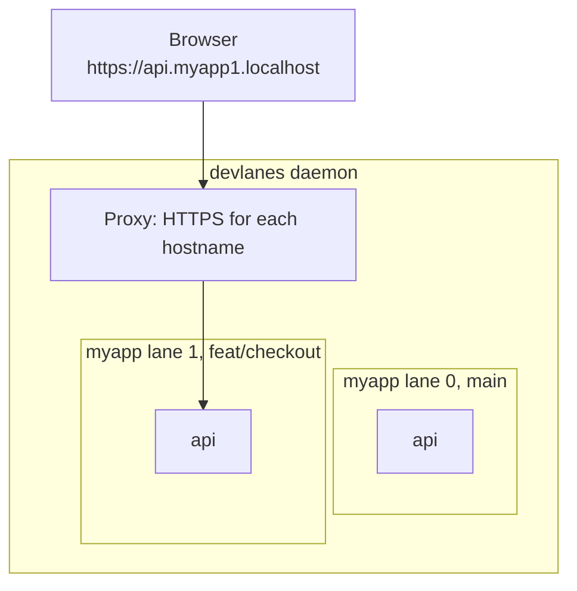

devlanes runs your dev stack once per Git worktree, so two branches of the same project can be up at the same time. Each worktree gets a lane with ports and HTTPS hostnames of its own: the main branch at `https://myapp.localhost`, a feature branch at `https://myapp1.localhost`. Your project needs one small file, and each service has to listen on the port devlanes hands it.

Your coding agent can set it up for you.

```prompt
Install the devlanes skill:
npx skills add devlanes-run/devlanes --skill devlanes

Then install devlanes on this machine if it is missing, set it up for
this repository, start it and give me the URL of each service.
```

To do it by hand, start with [Install devlanes](install.md).

## A daemon and a proxy do the work



A daemon in the background runs the processes of each lane, so they keep running after you close the terminal. Its proxy answers each hostname over HTTPS and passes the request to the lane the hostname belongs to.

## Starting points

- To see how the pieces fit, read Learn from its first page, [A service, a port and a hostname](learn/first-service.md).
- To put your own project on devlanes, see [Add devlanes to a project](how-to/projects/add-devlanes.md), or [Migrate from another process manager](how-to/projects/migrate.md).
- To let a coding agent start and test the project, see [Set up a coding agent](how-to/agents/set-up.md).
- To run lanes on another machine and open them in your own browser, see [Prepare a box](how-to/remote/prepare-a-box.md).
- For a hostname and HTTPS in front of a server you already run, see [Give a server you run yourself a hostname](how-to/services/external.md).
