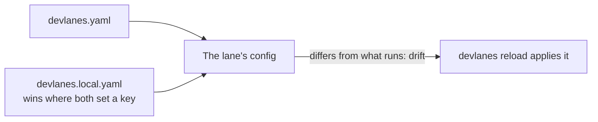

A lane reads its config from the project file and from the local file next to it. devlanes merges them into one config and watches them while the lane runs. When you edit one, your running processes keep what they started with, status shows what differs, and you choose when to apply it.

## The local file wins over the project file

Unless you name a file with `--file`, devlanes loads the nearest `devlanes.yaml` in the folder you are in or one above it, up to the repository root. Next to it sits the local file, `devlanes.local.yaml`, which holds what you want on your machine only and wins where both set the same thing.



Settings merge by key, so a local file that sets one variable of a service keeps the others; a list in the local file replaces the whole list. A project file can also build on another project file, as a production file builds on the development one, and then the files merge in the order the diagram shows.

You keep the local file out of Git yourself by adding it to `.gitignore`. It cannot rename the project, so every machine gives the project the same lanes and domains. A worktree without a local file of its own reads the one in the primary worktree. [Keep personal changes out of Git](../how-to/projects/local-overrides.md) shows what such a file usually holds.

## An edit leaves running processes alone

The daemon notices when a file it loaded changes and reads the config again, but it does not stop or restart anything because of that. Each running service keeps the command and environment it was started with until you apply the change.

Hostnames are the exception, because they change the proxy and not a process: an edited hostname is routed as soon as the file loads.

## Drift is the difference status shows

devlanes remembers what each running service was started with and compares it with what the current config would start. That difference is drift. Status marks the lane and names each service that would be changed, removed or added, with the fields that differ.

## Reload applies the difference

A reload restarts the services that changed, stops the ones the file removed, starts the ones it added, and leaves the rest running.

```console
$ devlanes reload
```

When the edit changes the containers or needs more ports than the lane has, a reload restarts the whole lane instead, since those only change while nothing in the lane runs. A reload keeps the environment the lane already has; [Environment and expressions](environment.md) says which commands bring in a new one from your shell.

## A file that does not load leaves the lane as it was

A typo or a rebase conflict stops the config from loading. While the lane runs, it keeps its hostnames and routes on the last config that loaded, so a half-finished edit does not take running services off the proxy. Status shows the error with the file and the line, and starts and reloads of the lane refuse until the file loads again.

## Related

- [Keep personal changes out of Git](../how-to/projects/local-overrides.md)
- [Run dev servers and a production build side by side](../how-to/projects/dev-and-prod.md)
- [Share settings and choose which services start](../how-to/projects/templates-and-profiles.md)
- [When a service fails](../learn/failures.md)
