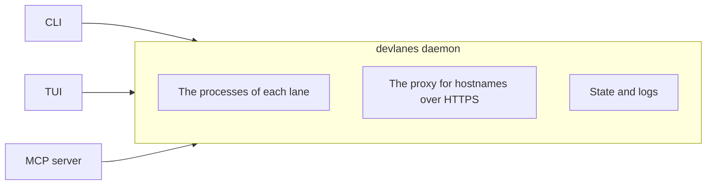

One background process per user, the daemon, runs the lanes of all your projects. The command line, the TUI and the MCP server, which lets a coding agent call devlanes, only send it requests and show what it reports. Because the processes belong to the daemon and not to a terminal, closing a terminal or quitting the TUI leaves your lanes running.

## The daemon holds the lanes

The daemon starts and stops each unit of a lane, a service or task for example ([Glossary](../reference/glossary.md)). It hands out the ports, runs the proxy that answers the hostnames, keeps the state of each lane and writes the logs. A client holds none of this, so a terminal and an agent looking at the same lane see the same thing.



The daemon measures the CPU and memory of each lane and shows them in status, and it does not limit them. A lane nobody uses is throttled and then frozen instead of stopped ([Throttling and freezing](freezing.md)).

`devlanes daemon stop` stops the daemon and every process it runs. Containers keep running, but their hostnames answer only while a daemon runs.

## It starts on first use and exits when nothing runs

The first command that needs the daemon starts it, so there is nothing to start by hand. A daemon started that way exits by itself a short while after nothing runs in any lane, no TUI is open and no box, a machine whose lanes are mirrored to yours, is connected. The next command starts it again.

To keep the daemon up and have it start when you log in, install it as a login service:

```console
$ devlanes daemon install
```

On Windows, some terminals end the processes they started when they close, a daemon included; [Windows](../reference/windows.md) says which.

## A reboot leaves the lanes waiting for a shell

The daemon remembers which services each lane ran. It does not keep the environment of the shell that started them, which [Environment and expressions](environment.md) explains. After a reboot the lanes run nothing and keep their numbers, ports and hostnames, and status says each needs a start from a shell.

One command from a shell brings them back. In a worktree, a plain start brings back its own lane; anywhere, a resume brings back every lane you did not stop by hand, with the services each one ran:

```console
$ devlanes lane resume
```

[Bring lanes back after a reboot](../how-to/lanes/after-a-reboot.md) has both paths, and `devlanes daemon restart` restarts the daemon and its lanes in one step.

## A failed service stays failed

When a service exits or cannot start, it shows as failed with its error and the end of its output. It stays that way until you start, restart or stop it, because devlanes does not restart a failed unit by itself: the failure stays in view so you see what broke. [When a service fails](../learn/failures.md) shows what that looks like.

A dev server that reloads itself after a file change keeps its process, so it does not count as failed.

## Related

- [A service, a port and a hostname](../learn/first-service.md)
- [Bring lanes back after a reboot](../how-to/lanes/after-a-reboot.md)
- [Throttling and freezing](freezing.md)
- [Security](security.md)
