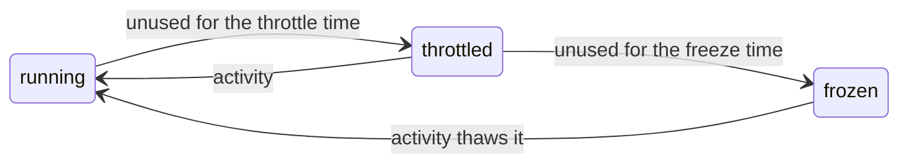

A machine with several lanes runs several copies of each dev server and watcher, and many of them sit unused while you work in one lane. devlanes slows an unused lane down, then freezes it, and thaws it when something uses it again. Its processes are not stopped or restarted along the way, so the lane comes back where it was.

## An unused lane is throttled, then frozen

By default a lane is throttled after 5 minutes without activity: its processes run at background priority and keep serving requests. By default it is frozen 15 minutes after its last activity: its processes are suspended, and the containers that belong to the lane alone are paused. Both apply to the whole lane, so activity on one service thaws all of them.

Shared containers, such as one Postgres for every lane, are not paused, since other lanes use them. Linux lanes are not throttled and go straight to frozen. The two times are [`lanes.throttle_after`](/docs/reference/config/user/lanes/) and [`lanes.freeze_after`](/docs/reference/config/user/lanes/) in the user config, and [Run many lanes on one machine](../how-to/lanes/many-lanes.md) changes them.

## A frozen lane keeps its state

A frozen process keeps its memory, its open files, its ports and its PID. The lane keeps its hostnames and its environment, and a connection to one of its ports waits until the lane thaws and answers it. A restart would throw away a dev server's state and caches; a frozen process carries on where it stopped.

Closing the lid stops nothing either. The machine sleeps with the daemon and every lane in it, and in the morning a frozen lane stays frozen until your first request thaws it.

## Using a lane thaws it

These count as activity, reset the lane's timer and thaw it:

- a request through the devlanes proxy to one of the lane's hostnames, or bytes your browser sends on an open WebSocket
- a new connection to one of the lane's ports, as a database client makes
- a devlanes command that needs the lane's processes, such as a start, a stop or an exec

A request to a frozen lane waits while the lane thaws and then goes through, so you see a short pause and no error. Commands that only look at a lane, such as reading its logs or its status, do not count, so a TUI left open does not keep a lane awake.

## Some lanes stay awake

A busy lane does not freeze: one that is starting or stopping, or that runs a task or a command started with `devlanes exec`. A worker or queue consumer does its work without requests and would stall in a frozen lane, so mark it with [`services.<name>.keep_awake`](/docs/reference/config/project/services/) to keep its whole lane awake.

Some lanes stay awake without being told. A browser tab whose dev client pings over a WebSocket counts as activity for as long as it is open, and closing the tab lets the lane freeze.

## Related

- [Run many lanes on one machine](../how-to/lanes/many-lanes.md)
- [`lanes.freeze_after`](/docs/reference/config/user/lanes/)
- [The daemon](daemon.md)
- [Start order and readiness](start-order.md)
