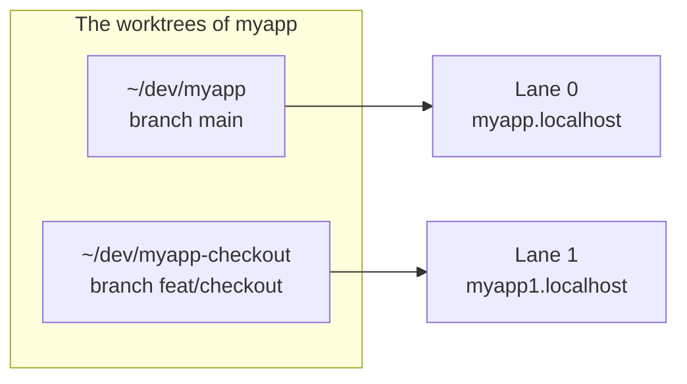

You work on two branches at once, each in a Git worktree of its own. devlanes runs a lane for each worktree: a running copy of the project with its own number, hostnames, ports and data folder. The project is what one project file describes, and its name is what ties the lanes together.

## Each worktree runs its own lane

A worktree is a folder with one branch checked out. Each lane belongs to one worktree, so lanes in two worktrees share no source files, installed dependencies or build output. When you move a worktree with `git worktree move`, its lane follows it.

What a lane runs are its units, mostly the services and tasks of the project file, next to the containers the project declares, such as a database ([Glossary](../reference/glossary.md)).



## Lanes are numbered

The primary worktree, the folder you cloned into, is lane 0, the main lane, whatever branch it has checked out. Any other worktree gets the lowest free number the first time you run devlanes in it, with a start or a status, for example. Creating a worktree with Git does nothing by itself.

Lane 0 is named main and the others lane1, lane2 and so on, whatever their branch. Values built from the name differ per lane, which is how each lane gets a database of its own:

```yaml devlanes
lanes:
  vars:
    db_name: myapp_${{ lane.name }}
```

That gives myapp_main in lane 0 and myapp_lane1 in lane 1. The number also gives the lane its domain, as [Hostnames and HTTPS](hostnames-and-https.md) describes.

Each lane also has a data folder outside its worktree, for files that no other lane may share, such as a local database file ([Files and folders](../reference/files.md#lane-data-folder)).

## A deleted worktree keeps its lane until you clean it

When you remove a worktree after a merge, devlanes stops what its lane ran but keeps the lane: its number, ports, data folder and containers. A new worktree takes another number in the meantime. `devlanes lane gc` cleans the lanes whose worktree is gone, and cleaning deletes the lane's data folder and its own containers. [Remove lanes](../how-to/lanes/clean-up.md) covers this, and how to have it happen by itself.

## A project is known by its name

The `project` name in the project file builds each lane's domain and the names of the containers devlanes creates, and commands use it to name a lane, as in `myapp@1`. Every worktree of a repository shares the name, so every worktree is a lane of the same project.

Renaming the project makes a new project, with new lanes, ports and domains; the old lanes stay until you clean them. A name belongs to one repository, so on one machine use worktrees of one clone rather than a second clone.

## One repository can hold several projects

A command uses the nearest project file above the current folder, up to the root of the repository. So an app in a monorepo can be a project of its own, with a project file in its folder and a name of its own:

```yaml devlanes
# apps/billing/devlanes.yaml
project: billing
```

A worktree then holds a lane of each project, with domains of its own. [Split a monorepo into projects](../how-to/projects/monorepo.md) weighs one project against several, and [Run dev servers and a production build side by side](../how-to/projects/dev-and-prod.md) adds a second project file to one folder.

## Related

- [Every worktree gets a lane](../learn/worktrees.md)
- [Remove lanes](../how-to/lanes/clean-up.md)
- [Ports](ports.md)
- [Glossary](../reference/glossary.md)
