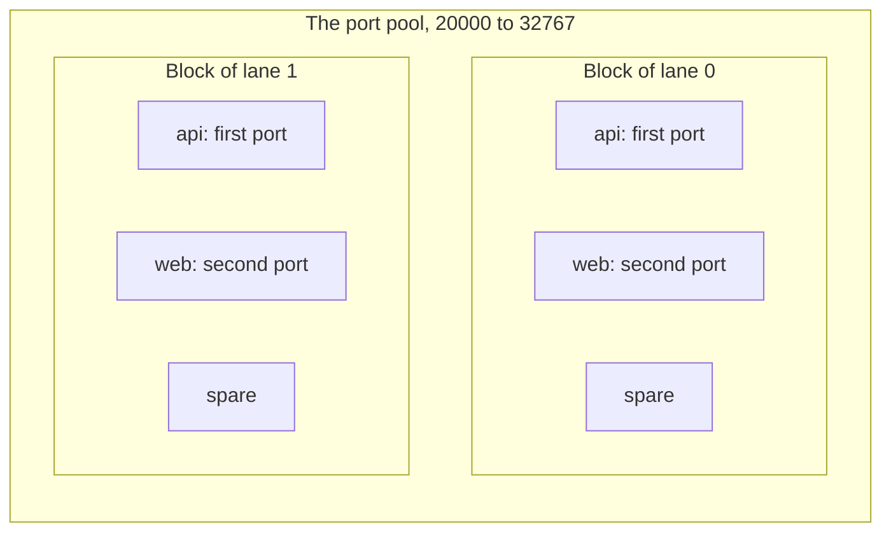

The lanes of all projects on a machine take their ports from one shared pool, so several projects, and several lanes of each, run at the same time without anyone keeping a list of ports. A service does not choose its port. devlanes hands it one and the service listens there.

## Each lane takes a block from one pool

The pool runs from 20000 to 32767 by default, below the range Linux usually picks ports for outgoing connections from, so the system does not hand a lane's port to another program. [`ports.range`](/docs/reference/config/user/ports/) moves it.

A new lane takes the lowest free block of consecutive ports, and no two blocks overlap, whatever project they belong to. A block holds the ports the project needs with room to spare, at least ten, so adding a service usually fits in the block the lane already has.



## A service has the same place in every lane

Inside the block each service has the same offset in every lane of the project. If the API is the first port of lane 0's block, it is the first port of lane 1's block too. devlanes stores these offsets, so a service keeps its port across restarts, edits of the project file and branch switches.

When the services you add no longer fit, the lane moves to a larger block the next time it restarts as a whole, and its ports change.

## A service is handed its port

devlanes passes each service its port in the `PORT` variable and the address to listen on in `HOST`. The proxy, the ready check and other services all reach the service there, so the one thing your code has to do is listen on that port. A dev server that takes its port as a flag gets it from an expression instead:

```yaml devlanes
services:
  web:
    run: python -m http.server ${{ self.port }} --bind 127.0.0.1
```

## A service can have more ports

A service that needs a second port, for a debugger or for metrics, names it in an expression, and devlanes gives it one in the same block, at the same place in every lane:

```yaml devlanes
services:
  api:
    run: node --inspect=127.0.0.1:${{ self.ports.inspect }} server.mjs
```

[Give a service several ports and hostnames](../how-to/services/ports-and-hostnames.md) routes a hostname to such a port.

## Ports differ between machines and hostnames do not

Each machine has its own pool and its own lanes, so the ports of a lane depend on what else that machine runs. A colleague who clones myapp gets other port numbers than yours. Hostnames are built from the project name and the lane number, so `api.myapp.localhost` names lane 0's API on both machines. Put hostnames, not ports, in a README, a bookmark or an OAuth callback.

## Related

- [Every worktree gets a lane](../learn/worktrees.md)
- [Give a service several ports and hostnames](../how-to/services/ports-and-hostnames.md)
- [Lanes and projects](lanes-and-projects.md)
- [Hostnames and HTTPS](hostnames-and-https.md)
