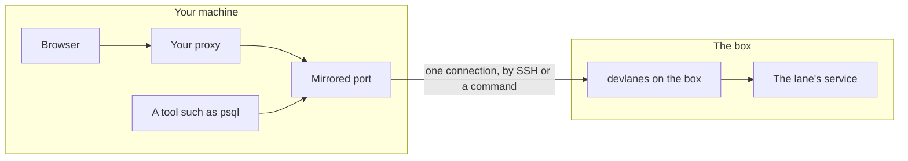

A box is a machine that runs devlanes for its own lanes, such as a server that has more room than your laptop. When your machine connects to it, the box's lanes appear on your machine under the hostnames and port numbers the box gave them, and folders the box builds can be copied to your machine as they change. You start and stop those lanes on the box itself; the connection carries what they serve, not what controls them.

## Two daemons share one session

Each machine runs its own daemon. The daemon on your machine owns the connection: it opens one session to the box, over SSH or a command that reaches a container, listens on the box's ports, adds the box's hostnames to its proxy and writes the folders the box syncs. The daemon on the box runs the box's lanes as it would with nobody connected.

The session belongs to your daemon and not to a terminal, so it outlives the terminal that opened it and reconnects on its own after the network drops. Run the same devlanes release on both machines; [Prepare a box](../how-to/remote/prepare-a-box.md) covers installing one.

## The session carries traffic, not control

The box tells your machine which lanes and services it runs, then carries the bytes of each connection you make to them and the files of each synced folder. A synced folder goes one way, from the box to your machine, so something the box builds, such as a browser extension you load unpacked, appears on your machine as it changes.

Environments, secrets, logs and commands do not cross, and neither does either machine's CA. Your machine cannot start, stop or run anything on the box through the session; to change a lane, you work on the box, over SSH or in an editor's remote terminal. A box serves only machines you paired with it, and [Security](security.md) explains what pairing protects.

## A box keeps its hostnames and ports

The box's services got their URLs when they started, and those URLs end up in their config, in CORS lists and in cookies. Your machine passes them through unchanged: each port listens on your machine's loopback under the same number, and each hostname joins your proxy, which serves it with your CA. A browser on your machine trusts the box's hostnames once your machine trusts its own CA, and nothing in the box's code has to change.

Renaming the hostnames or moving the ports on your machine would break each URL the box already handed out, so a port your machine already uses stays yours: it is reported instead of mirrored, and a client that names that number reaches your own program instead of the box. The box's hostnames still work.

## One box serves a lane at a time

Two boxes made from one image run the same lane with the same hostnames and ports, and a port number on your machine can lead to only one of them, so one box serves the lane whole, and the other is skipped rather than renamed. A lane running on your machine wins over a box's lane with the same hostnames. `devlanes remote use` chooses which box serves a lane, and [Work with several boxes](../how-to/remote/several-boxes.md) covers switching.

## Related

- [Lanes on another machine](../learn/remote.md)
- [Connect to a box](../how-to/remote/connect.md)
- [Choose what a box shares](../how-to/remote/what-a-box-shares.md)
- [Work with several boxes](../how-to/remote/several-boxes.md)
