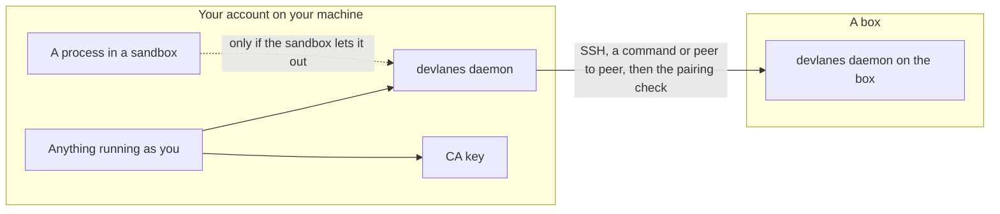

devlanes runs as your user. Its daemon answers processes of your account and no other, and each service and task runs with your permissions. Lanes keep ports, hostnames and data apart, but they do not keep code apart, and that shapes what you can trust devlanes with.

## Only your account reaches the daemon

The daemon listens on a socket, a named pipe on Windows, that only your account can open, and it turns away callers from other accounts. The daemon has no token or password: the account check is the whole of it.

Any process running as you can do what you can through the daemon: start and stop services, run commands in a lane, read logs and a lane's environment, your shell's secrets included. A dev server, or a dependency's install script, runs as you too and can do the same. A sandboxed process that is allowed to reach the daemon gets the daemon's rights, outside its sandbox; [Use devlanes from an agent sandbox](../how-to/agents/sandboxes.md) covers that case.

## A lane is not a sandbox

A lane has its own ports, hostnames, data folder and cookie site, so two lanes do not collide. Its processes still belong to the same user as every other lane's: a service in one lane can read another lane's files and connect to its ports. Code you do not trust belongs in a container or a separate account, not in a lane.

## The CA signs only local names

devlanes creates one CA for your user, with its key in `ca-key.pem` in the `ca` folder of the devlanes home, readable by your account only. Any process running as you can read that key and use it to make certificates your browsers trust. The CA is limited to local names, so a client that checks that limit refuses a certificate it signs for any name outside these:

- `localhost`
- `test`
- `internal`
- `home.arpa`
- the top-level domain in `hostnames.tld`, as set when the CA was created

In such a client, trusting the CA does not let it vouch for a real website. [Hostnames and HTTPS](hostnames-and-https.md) describes how the CA gets trusted.

## Pairing decides which machines see a box

A box is a machine whose lanes are mirrored to yours. SSH, or the command that reaches a box, decides who gets onto the box at all. Pairing decides which of the machines that get in see its lanes: the first time your machine connects, you give it a one-time code from the box, and it trades the code for a token it presents on each later connection. Revoking a machine on the box deletes its pairing and ends its connections.

Under ordinary SSH access, pairing is not a boundary. A machine that can open a shell on the box as you can hand itself a code, and so can an agent working there. Pairing protects the box's lanes only when a machine's SSH key on the box is restricted to running the devlanes tunnel.

The token is a bearer secret: any process running as you on the paired machine can copy it and connect as that machine. Revoking a machine leaves its SSH access as it was, so remove its key from the box as well. [Connect to a box](../how-to/remote/connect.md) has the steps.

## A ticket pairs whoever holds it

A box paired by ticket needs no SSH, so the pairing is the whole of the access check. Each machine has its own key, kept in `p2p-key` in the devlanes home and readable by your account only. A ticket from `devlanes daemon pair` holds the box's public key, a one-time secret, the box's relay and up to 8 of its IP addresses, local and public. The first machine that presents the secret within 10 minutes is paired, so pass a ticket on only over a channel you would trust with a password.

Pairing pins both keys. The box serves only the keys it paired with, and your machine accepts only the box's key from the ticket, so nobody in between can pose as either. While a ticket is open, the box takes pairing requests from any machine that reaches it; otherwise it turns away every key it did not pair with before any data is exchanged. Revoking a machine on the box deletes its keys and ends its connections, and nothing else gives it access. Any process running as you on a paired machine can copy its key and connect as that machine, as with the token.

## A relay and n0's DNS see who connects

Two machines find each other through a relay, by default `relay1.devlanes.run` and `relay2.devlanes.run`. Until a direct path forms, the relay forwards the encrypted handshake between them; lane traffic never goes through it. The relay sees which keys connect, from which IP address and port, when, and the size of each packet it forwards, and it cannot read them. The [devlanes relay](https://github.com/devlanes-run/relay) repository describes what it logs and how to host your own.

A box that waits for its paired machines publishes its key and its relay in n0's DNS service, `dns.iroh.link`, run by n0, the company that makes the iroh library devlanes connects with, and a machine that connects to the box may look that key up there. n0 sees the key, the relay and the IP address of each request. devlanes also asks your router to forward a port to your machine, over UPnP, NAT-PMP or PCP. [`remote.relays`](/docs/reference/config/user/remote/#remote-relays) set to an empty list turns off the relay and n0's DNS, and [`remote.port_mapping`](/docs/reference/config/user/remote/#remote-port_mapping) set to false turns off the router request.

On Windows, the firewall may ask once whether devlanes may use the network. Peer-to-peer connections can form without that permission, because each machine sends first and the firewall lets the answers in.

## A box trusts what it serves

A box's services see your connections as coming from the box itself. A service there that trusts local connections without a password, such as an admin page or a database, trusts every machine the box serves.

## The browser extension holds test passwords

The browser extension saves the usernames and passwords you sign in with on lanes. They are stored unencrypted in that browser. A page gets saved logins only when it is on an HTTPS lane route, and only those of that lane's project. Through devlanes, the extension can read your lanes, switch boxes and stop a lane on your machine before a switch. It never receives environments, secrets or logs. devlanes answers any extension with the id `konofbnhgejkgkonkleipkkpkphbfgee`, which the Chrome Web Store gave the devlanes extension. The extension's manifest carries the store's public key, so any extension loaded with that key gets the same id and the same access. Load the extension only from devlanes-run/browser.

A lane page still has some reach. In browsers that can't restrict the extension's storage to its own pages, such as Chrome 120, a compromised page process could read the saved logins. On any version, a compromised page process on a lane can get the saved password of a username it knows, for that lane's project only. Page code can't do either. A lane page can submit its own form with values it chooses, and the extension saves them. One such submit replaces the saved password of a username. Twenty push out every real login of the project. A page can also draw its own content over the login menu and line up a click on one of its options. That needs a real click, and any extension's frame on a page has the same exposure.

## The daemon looks for new releases

The daemon reads the latest version from the registry devlanes was installed from, and installs patch releases from there in the background. The request carries nothing that identifies your machine or your projects. [Update and uninstall](../how-to/update.md) says how to turn this off.

## Related

- [Use devlanes from an agent sandbox](../how-to/agents/sandboxes.md)
- [Trust the devlanes CA](../how-to/hostnames/trust-the-ca.md)
- [Connect to a box](../how-to/remote/connect.md)
- [Connect to a box with a ticket](../how-to/remote/connect-by-ticket.md)
- [Remote mirroring](remote-mirroring.md)
- [Fill test logins on lanes](../how-to/fill-test-logins.md)
