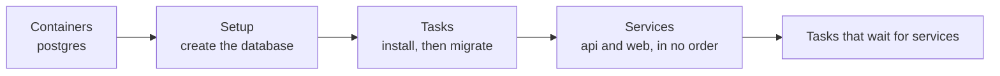

When you start a lane, devlanes brings up its parts in a fixed order: the containers, then setup, then tasks, then the services, then the tasks that wait for services. The start returns once each service it started has passed its ready check or failed. Services do not wait for one another, so whatever has to be up first belongs in an earlier phase.

## A start runs in phases

Containers are the databases and other programs a project runs in Docker, such as one Postgres; [Glossary](../reference/glossary.md) has the other terms. Each phase begins once the one before it has ended, so a service finds its containers up and the work of setup and tasks done.

These phases run when a start brings the lane up from nothing running. A start in a lane that already runs only adds the services it is missing, such as one you just added to the project file.

## Setup prepares containers, tasks prepare the worktree

Setup entries are commands for the lane's containers, such as creating the lane's own database in a shared Postgres. devlanes runs each one the first time the lane starts and remembers that it succeeded.

Tasks are one-off commands bound to a moment in the lane's life, and they run one at a time in the order the project file lists them. A `lane.create` task runs until it has succeeded once for the lane, which suits installing dependencies in a new worktree. A `lane.start` task runs each time a start brings the lane up, which suits migrations. A task can also wait until the services are ready, as a seed that goes through the API does. [Run installs, migrations and seeds](../how-to/services/tasks.md) sets these up.

## Ready means the ready check passed

A ready check is how devlanes tells that a service works: a port that accepts connections, a route that answers or a line in its log. A service with a hostname and no check counts as ready once its port accepts connections. [Wait until a service is ready](../how-to/services/ready-checks.md) shows how to choose one.

When a check never passes, the service becomes failed and devlanes leaves its process running, so its logs and its port are there for you to inspect. The other services go on starting. A failed service stays failed until you start, restart or stop it, as [The daemon](daemon.md) explains.

## Starts take turns on the machine

Each service start waits at the start gate, a queue shared by every lane and project on the machine, before it spawns. The gate lets a few services start at once and fewer while the machine is busy, so starting many lanes after a reboot does not grind it to a halt. It only delays spawns; a service that runs is not slowed. The [`startup`](/docs/reference/config/user/startup/) settings change it.

## Services do not wait for each other

A service cannot name another service it depends on, and devlanes does not order services by what they need from each other. Ports are given out before any service starts, so each service can be told the URL of another even though that one is not listening yet; [Environment and expressions](environment.md) explains how.

For you, the waiting moves into your code. If the database is itself a service, it starts together with the API, and the API has to retry its first connection until the database answers. Run the database as a container instead and it is up before any service starts.

## Related

- [Run installs, migrations and seeds](../how-to/services/tasks.md)
- [Wait until a service is ready](../how-to/services/ready-checks.md)
- [Run many lanes on one machine](../how-to/lanes/many-lanes.md)
- [`startup`](/docs/reference/config/user/startup/)
