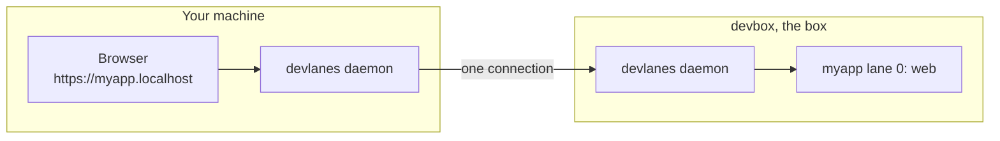

The main branch of myapp moves onto a box: a machine that runs lanes of its own, which your machine mirrors under the same hostnames and port numbers. Here the box is devbox, a container you reach with Docker's exec command. A VPS reached over SSH works the same way.

## The box runs myapp

devbox has devlanes installed, a Docker engine of its own and a clone of myapp on the main branch. [Prepare a box](../how-to/remote/prepare-a-box.md) has the steps.

```console title="on the box"
$ devlanes start --no-ui
```

Lane 0 of myapp starts on the box, with its own Postgres container, at `myapp.localhost` and `api.myapp.localhost`.

## You pair your machine once

```console title="on the box"
$ devlanes daemon pair
```

The box prints a one-time pairing code. By default it serves only machines that have paired with it.

On your machine, your user config gets one entry that says how to reach the box: a command that runs devlanes' end of the connection inside the container.

```yaml devlanes-user
remote:
  boxes:
    devbox:
      command: [docker, exec, -i, devbox, devlanes, tunnel, --stdio]
```

```console title="~/dev/myapp"
$ devlanes remote connect devbox --background --code V7G3-AFH2
```

Your daemon connects to the box and keeps the connection. It trades the code for a token, so later connections need no code. A box you reach over SSH needs no entry: `devlanes remote connect` takes the SSH destination.

## You choose the box's lane

```console title="~/dev/myapp"
$ devlanes remote use devbox myapp@0
```

From then on, the hostnames of myapp's lane 0 lead to devbox. A lane on your own machine with the same hostnames keeps them until you choose the box's lane this way.

## The browser opens the box's lane

You open `https://myapp.localhost` in the browser on your machine. Your daemon answers it with a certificate from the devlanes CA, a certificate authority devlanes creates on your machine, and sends the request over the connection to the web app on the box. The box's ports are mirrored on your machine under the same numbers, so a tool on your machine reaches them on `127.0.0.1` as well.



You start and stop the box's lane in a shell on the box, and work with it from your machine as if it ran here.

## On your own project

- [Prepare a box](../how-to/remote/prepare-a-box.md)
- [Connect to a box](../how-to/remote/connect.md)
- [Connect to a box with a ticket](../how-to/remote/connect-by-ticket.md)
- [Connect to a box through a command](../how-to/remote/connect-by-command.md)
- [Work with several boxes](../how-to/remote/several-boxes.md)
- [Remote mirroring](../concepts/remote-mirroring.md)
